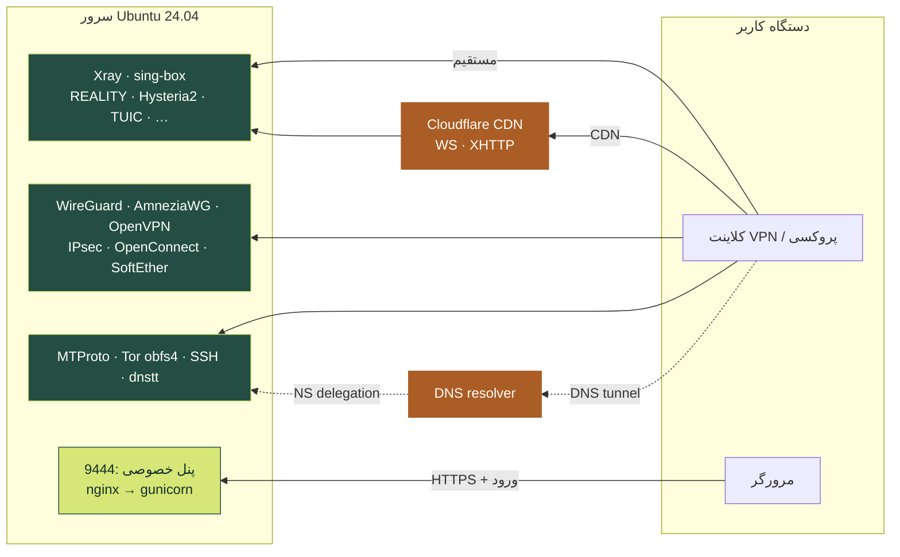

<p align="center">
  <a href="https://sabi-karami.github.io/SABI-ALL-VPN/"></a>
</p>

<p align="center">
  <a href="https://github.com/sabi-karami/SABI-ALL-VPN/releases"></a>
  <a href="https://github.com/sabi-karami/SABI-ALL-VPN/actions/workflows/ci.yml"></a>
  <a href="LICENSE"></a>
  
  
  
</p>

<p align="center">
  <b><a href="#install">نصب سریع</a></b> ·
  <b><a href="#protocols">نقشهٔ اتصال‌ها</a></b> ·
  <b><a href="#panel">پنل فارسی</a></b> ·
  <b><a href="#flow">مسیر نصب</a></b> ·
  <b><a href="#zip">ZIP خصوصی</a></b> ·
  <b><a href="#limits">محدودیت‌ها</a></b> ·
  <b><a href="#docs">مستندات</a></b> ·
  <b><a href="#english">English</a></b>
</p>

**SABI ALL VPN** یک نصب‌کنندهٔ چندروشی برای **سرور اختصاصی** است: با یک دستور ده‌ها روش اتصال (Xray، sing-box، WireGuard، OpenVPN، IPsec و …) را نصب می‌کند، برای هر نصب کلید و رمز تازه می‌سازد و همه‌چیز را در یک **پنل خصوصی فارسی با کلیک‌برای‌کپی** و یک **ZIP خصوصی کامل** تحویل می‌دهد.

> [!IMPORTANT]
> **نسخهٔ آزمایشی `v1.0.0-beta.4` — فقط Ubuntu 24.04 / x86-64.** این پروژه مجموعهٔ مشخص‌شدهٔ پایین را خودکار نصب می‌کند؛ «تمام پروتکل‌های VPN دنیا» نیست. ۳۰ کارت پنل شامل حالت‌های مختلف یک پروتکل است، نه ۳۰ استاندارد مستقل. هیچ کلید یا رمز واقعیِ هیچ سروری در این مخزن عمومی نیست.

<table>
<tr>
<td width="25%" align="center"><b>⚡ یک دستور</b><br><sub>سرور آماده یا ساخت خودکار در AWS</sub></td>
<td width="25%" align="center"><b>🧩 ۳۰ کارت</b><br><sub>مستقیم، Cloudflare، کلاسیک، ابزارها</sub></td>
<td width="25%" align="center"><b>📋 کلیک = کپی</b><br><sub>پنل فارسی با آموزش هر روش</sub></td>
<td width="25%" align="center"><b>🔐 رمز تازه</b><br><sub>برای هر نصب، بدون بازاستفاده</sub></td>
</tr>
</table>

<a name="install"></a>
## ⚡ نصب سریع

### ۱ · سرور آماده دارید

روی **سرور تازهٔ Ubuntu 24.04 amd64** وارد SSH شوید و فقط همین یک خط را اجرا کنید:

```bash
bash <(curl -fsSL https://raw.githubusercontent.com/sabi-karami/SABI-ALL-VPN/v1.0.0-beta.4/bootstrap.sh)
```

> [!TIP]
> **پیش‌نیازها خودکار نصب می‌شوند.** اگر `curl`، Python 3، `python3-venv` یا گواهی‌های CA روی سرور نباشند، bootstrap خودش آن‌ها را نصب می‌کند و بعد ادامه می‌دهد؛ لازم نیست کاربر کاری دستی انجام دهد. اگر حتی `curl` برای اجرای همین خط اول وجود ندارد، همین دستور با `wget` هم کار می‌کند:
>
> ```bash
> bash <(wget -qO- https://raw.githubusercontent.com/sabi-karami/SABI-ALL-VPN/v1.0.0-beta.4/bootstrap.sh)
> ```

اسکریپت در صورت نیاز `sudo` می‌خواهد و نام دامنه، پیشوند ساب‌دامین‌ها، IPv4 و روش تنظیم DNS را می‌پرسد. در حالت Cloudflare، توکن را **فقط در ورودی مخفی ترمینال خودتان** وارد کنید؛ نه در چت، دستور shell، فایل عمومی یا GitHub.

### ۲ · سرور هم در AWS ساخته شود

روی Linux، WSL یا macOS با **Bash** و حساب AWS از قبل احراز هویت‌شده (curl، Python 3 و venv در صورت نبودن خودکار نصب می‌شوند):

```bash
bash <(curl -fsSL https://raw.githubusercontent.com/sabi-karami/SABI-ALL-VPN/v1.0.0-beta.4/bootstrap.sh) --aws
```

> [!WARNING]
> حالت AWS **پس از تأیید `CREATE` هزینه‌زا است** (EC2، EBS، IPv4 ثابت، ترافیک). منطقهٔ پیش‌فرض `us-east-2` و قابل انتخاب است؛ محدودیت SCP/Quota دور زده نمی‌شود. به مجوز ساخت EC2، IAM role/profile، SSM و یک VPC پیش‌فرض با subnet عمومی نیاز دارید. سقف هزینهٔ خودکار وجود ندارد. از زنجیرهٔ استاندارد اعتبارنامهٔ boto3 (AWS profile یا SSO) استفاده می‌شود.

<details>
<summary><b>🔎 روش قابل‌ممیزی‌تر: دانلود، بررسی و بعد اجرا</b></summary>

اجرای کد اینترنت با دسترسی root ریسک دارد. پیش از اجرا کد را بخوانید؛ نسخهٔ مشخص بهتر از شاخهٔ متغیر `main` است:

```bash
curl -fL https://github.com/sabi-karami/SABI-ALL-VPN/archive/refs/tags/v1.0.0-beta.4.tar.gz -o sabi-source.tgz
tar -xzf sabi-source.tgz
cd SABI-ALL-VPN-1.0.0-beta.4
sha256sum -c MANIFEST.sha256
sudo bash install.sh
```

`MANIFEST.sha256` برای تشخیص تغییر و خرابی فایل‌هاست؛ امضای مستقل یا تضمین اعتماد به ناشر نیست.

</details>

<a name="protocols"></a>
## 🧩 نقشهٔ اتصال‌ها

<p align="center"></p>

<details>
<summary><b>نسخهٔ متنی جدول</b></summary>

| گروه | موارد |
|---|---|
| Xray / مستقیم | VLESS-REALITY روی 443، Trojan-TLS، Shadowsocks-2022 |
| sing-box / مستقیم | REALITY سازگار sing-box روی 3443، Hysteria2، TUIC، ShadowTLS v3 + SS2022، AnyTLS، Naive |
| Cloudflare | VLESS-WS، VLESS-XHTTP، VMess-WS، Trojan-WS |
| VPN کلاسیک | WireGuard، AmneziaWG، OpenVPN UDP/TCP، IKEv2، L2TP/IPsec، IPsec-XAuth، OpenConnect، SSTP/SoftEther |
| ابزارها | MTProto تلگرام، پل خصوصی Tor/obfs4، dnstt، SSH SOCKS tunnel |
| اختیاری و پیش‌فرض خاموش | PPTP ناامن؛ پروکسی خام SOCKS5/HTTP روی 1080 |

پورت‌ها و مسیرها با جزئیات: [docs/PORTS.md](docs/PORTS.md)

</details>

PPTP و پروکسی خام را فقط اگر آگاهانه لازم دارید فعال کنید. انتخاب هر دو، مجموعهٔ حداکثری ۳۰ کارت را می‌دهد؛ پیش‌فرض ۲۷ کارت است. هر نصب کلید و رمز تازه می‌سازد.

**نصب نمی‌شوند:** NordLynx و پروتکل‌های اختصاصی خدمات تجاری، MPLS/EVPN و زیرساخت اپراتوری، شبکه‌های Mesh، Psiphon، I2P، MASQUE و هر مورد خارج از فهرست بالا.

<a name="panel"></a>
## 📋 پنل خصوصی فارسی

<p align="center"></p>
<p align="center"><sub>تصویر بالا <b>نمایشی و با دادهٔ ساختگی</b> است (<code>vpn.example.com</code>، <code>192.0.2.10</code>). اسکرین‌شات پنل واقعی منتشر نمی‌شود، چون رمزها و IP سرور را نشان می‌دهد.</sub></p>

| | قابلیت |
|:-:|---|
| 🌐 | آدرس `https://SUBDOMAIN:9444` — نام کاربری پیش‌فرض `sabi` (در wizard قابل انتخاب) |
| 🔑 | رمز اولیهٔ تصادفی؛ حداقل طول رمز جدید ۸ نویسه (ترکیب طولانی‌تر توصیه می‌شود) |
| 📋 | کلیک برای کپی، پنهان/نمایش رمز، فیلتر و جستجو، آموزش قدم‌به‌قدم هر روش |
| 📁 | دانلود و پیش‌نمایش فایل‌های کلاینت پس از ورود |
| 🛡️ | cookie با Secure/HttpOnly/SameSite، CSRF، محدودیت تلاش ورود، no-store |
| 💓 | وضعیت سرویس‌ها تقریباً هر دقیقه — **تست اتصال از اینترنت کاربر نیست** |
| 📖 | read-only: ساخت کاربر، فروش اشتراک، حسابداری مصرف و محدودیت حجم ندارد |

اطلاعات ورود اولیه روی سرور:

```bash
sudo cat /root/allvpn/panel-access.txt
```

پس از اولین ورود رمز را از «راهنما و امنیت» تغییر دهید. فایل بالا رمز اولیه است و پس از تغییر به‌روز نمی‌شود.

<a name="flow"></a>
## 🛠️ مسیر نصب

<p align="center"></p>

نصب بعد از پرسش‌های اولیه در سرویس systemd جدا ادامه می‌یابد؛ بستن SSH نصب را متوقف نمی‌کند:

```bash
sudo tail -f /var/log/sabi-allvpn-install.log
sudo systemctl status sabi-allvpn-install
```

خطا را اصلاح و همان نصب را ادامه دهید:

```bash
sudo bash /opt/sabi-allvpn/install.sh --resume
```

checkpoint در `/var/lib/sabi-allvpn/done/` ثبت می‌شود و مراحل موفق رد می‌شوند. مرحلهٔ شکست‌خورده ممکن است تغییر جزئی انجام داده باشد؛ این پروژه تراکنش یا rollback کامل نرم‌افزارهای ثالث نیست. روی سروری که سرویس دیگری دارد اجرا نکنید.

<details>
<summary><b>🗺️ معماری ترافیک (نمودار Mermaid)</b></summary>



</details>

<a name="zip"></a>
## 📦 ZIP خصوصی کامل

پس از تکمیل نصب:

```text
/root/allvpn/export/allvpn-private.zip
```

شامل فایل‌های کلاینت، راهنمای فارسی، رمزهای VPN، پشتیبان تنظیمات سرور، کلیدهای خصوصی و **رمز اولیهٔ پنل** است؛ شامل کلید API AWS/Cloudflare نیست.

> [!CAUTION]
> ZIP رمزنگاری‌شده نیست. آن را در محل امن نگه دارید و **هرگز در GitHub عمومی، Issue یا Release آپلود نکنید.**

```bash
scp admin@YOUR_SERVER:/path-you-securely-copied/allvpn-private.zip ./
```

فایل root-only است؛ با حساب ادمین به‌صورت کنترل‌شده کپی کنید. کاربر `tunnel` شِل/دسترسی مدیریتی ندارد؛ از Session Manager یا حساب مدیریت خود استفاده کنید. فایل‌های معمول اتصال پس از ورود در پنل هم دانلود می‌شوند.

<details>
<summary><b>به‌روزرسانی خروجی پس از تغییر فایل‌ها</b></summary>

```bash
sudo /opt/allvpn-panel/venv/bin/python /opt/allvpn-panel/build_files.py
sudo chown -R allvpn-panel:allvpn-panel /var/lib/allvpn-panel
sudo python3 /opt/sabi-allvpn/scripts/export_private.py
```

این کار configهایی را که بعداً با دست ویرایش کرده‌اید به معنای «مهاجرت خودکار» تفسیر نمی‌کند. کاتالوگ متنی ممکن است نیازمند بازتولید توسط مدیر باشد.

</details>

<a name="limits"></a>
## ⚠️ حد تست و ریسک‌ها

| وضعیت | مورد |
|:-:|---|
| ✅ | syntax همهٔ Bash/Python، JSONهای اصلی، کنترل دسترسی پنل و مرز رمز ۷/۸ نویسه در CI تست می‌شوند |
| ✅ | پنل مبنا قبلاً با مرورگر دسکتاپ/موبایل و دانلود احراز هویت‌شده تست شده بود |
| ⏳ | **نصب کامل fresh-host و AWS provisioning انتهابه‌انتهای این نسخهٔ یکپارچه هنوز انجام نشده است** — اول روی ماشین آزمایشی disposable امتحان کنید |
| ⚠️ | بسته‌های apt، وابستگی‌های build و بعضی دانلودهای nested نصب‌کنندهٔ IPsec کاملاً قفل نیستند؛ build صددرصد reproducible نیست (هسته‌ها در `versions.lock.json` قفل‌اند) |
| ℹ️ | نصب خودکار پیش‌نیازها با apt، dnf، yum، zypper، apk، pacman یا Homebrew انجام می‌شود و دسترسی root/sudo لازم دارد (ممکن است رمز sudo بپرسد). Bash باید از قبل باشد. روی macOS بدون Homebrew، Python را خودتان نصب کنید |
| ⚠️ | گرفتن گواهی، تأخیر DNS، فیلترینگ، سیاست دیتاسنتر و تفاوت کلاینت‌ها ممکن است باعث خطا شوند |
| ⚠️ | IPv4 در اولویت است؛ مسیر IPv6 در فایل‌های WG/AWG تنظیم نشده. IPv6 را روی کلاینت مدیریت/مسدود کنید؛ تضمین جلوگیری از نشت وجود ندارد |

<a name="docs"></a>
## 📚 مستندات

| | سند | موضوع |
|:-:|---|---|
| 📘 | [PROTOCOLS.fa.md](docs/PROTOCOLS.fa.md) | آموزش فارسی همهٔ روش‌ها |
| ☁️ | [AWS.fa.md](docs/AWS.fa.md) | AWS، دسترسی‌ها، هزینه و حذف |
| 🌩️ | [CLOUDFLARE.fa.md](docs/CLOUDFLARE.fa.md) | Cloudflare، دامنه و TLS |
| 🔌 | [PORTS.md](docs/PORTS.md) | پورت‌ها و شبکه |
| 🧰 | [OPERATIONS.fa.md](docs/OPERATIONS.fa.md) | ادامهٔ نصب، عیب‌یابی، بازیابی |
| 🛡️ | [SECURITY.md](SECURITY.md) | امنیت و سیاست رمزها |
| 🧾 | [THIRD_PARTY.md](THIRD_PARTY.md) | نسخه‌ها و انتساب پروژه‌های ثالث |
| 🧪 | [TESTING.md](docs/TESTING.md) | گزارش آزمون |
| 🗂️ | [docs/README.md](docs/README.md) | فهرست کامل مستندات |

صفحهٔ معرفی گرافیکی: **<https://sabi-karami.github.io/SABI-ALL-VPN/>**

## 🤝 مشارکت و گزارش مشکل

- [راهنمای مشارکت](CONTRIBUTING.md) · [آیین رفتار](CODE_OF_CONDUCT.md) · [سیاست امنیت](SECURITY.md)
- برای خطا از [فرم گزارش خطا](https://github.com/sabi-karami/SABI-ALL-VPN/issues/new/choose) استفاده کنید. **هرگز رمز، کلید، IP واقعی، لینک اتصال یا ZIP خصوصی را در Issue قرار ندهید.**
- آسیب‌پذیری امنیتی را فقط از [گزارش خصوصی](https://github.com/sabi-karami/SABI-ALL-VPN/security/advisories/new) بفرستید.

<a name="english"></a>
## 🇬🇧 English summary

SABI ALL VPN is a **beta** multi-protocol installer for a **dedicated, fresh Ubuntu 24.04 amd64 host**. One command installs Xray, sing-box, WireGuard, AmneziaWG, OpenVPN, IPsec (IKEv2/L2TP/XAuth), OpenConnect, SoftEther/SSTP, MTProto, a private Tor obfs4 bridge, dnstt and an SSH SOCKS tunnel (27 cards by default, 30 with the unsafe opt-ins), generates fresh credentials per install and serves them in an authenticated Persian panel with click-to-copy plus a root-only private ZIP. An optional `--aws` mode provisions the EC2 host first (billable). Fresh-host and AWS end-to-end runs of this consolidated release are **not yet verified** — try it on a disposable VM first. The artwork in this README is illustrative and uses synthetic data only.

## 📄 مجوز

کد هماهنگ‌کننده و پنل این مخزن [MIT](LICENSE) است؛ پروژه‌های ثالث مجوزهای خودشان را دارند. فونت Vazirmatn تحت SIL OFL است ([متن مجوز](panel/static/OFL.txt)). این مخزن نرم‌افزارهای VPN را به نام خود بازنشر نمی‌کند و ادعای ممیزی امنیتی مستقل ندارد.

<p align="center"><sub>ساخته‌شده با ❤️ برای <a href="https://github.com/sabi-karami">@sabi-karami</a></sub></p>
